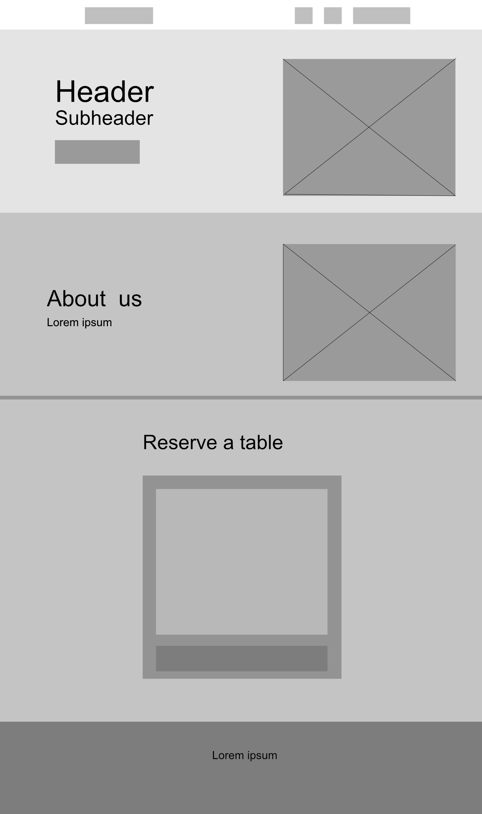

# Little Lemon

A mock website for a Chicago Mediterranean restaurant, built as a learning project with React.

## Wireframe



## Features

- Landing section, About us section and a "Reserve a table" form
- Responsive layout (desktop and mobile)
- Form built with [Formik](https://formik.org/) and validated with [Yup](https://github.com/jquense/yup)
- Simulated submission with a loading spinner and a disabled button
- Friendly error messages (empty fields, past dates, invalid email, fully booked time)
- Accessible: semantic landmarks, skip link, labelled fields, `aria-invalid` / `aria-describedby` errors, `role="alert"` messages
- Unit tests with Jest and React Testing Library

## Requirements

- [Node.js](https://nodejs.org/) 18 or newer (includes npm)

## Setup

```bash
npm install
npm start
```

Open <http://localhost:3000>. Photos load from Unsplash, so you need an internet connection.

## Scripts

| Command         | What it does                         |
| --------------- | ------------------------------------ |
| `npm start`     | Runs the app in development mode     |
| `npm test`      | Runs the tests in watch mode         |
| `npm run build` | Creates a production build in `build/` |

To run the tests once (no watch mode): `CI=true npm test` (macOS/Linux) or `$env:CI='true'; npm test` (PowerShell).

## Project structure

```
src/
  App.js           Page layout: header, sections, footer
  BookingForm.js   Reservation form (Formik)
  validation.js    Yup schema and time slots
  api.js           Fake server call (1.5s delay)
  App.test.js      Tests
  App.css          Styles
```

## Trying the error states

- Submit an empty form to see validation messages.
- Pick a date in the past (typed manually) to see the date error.
- Reserve for **20:00** to see the simulated "fully booked" server error.
